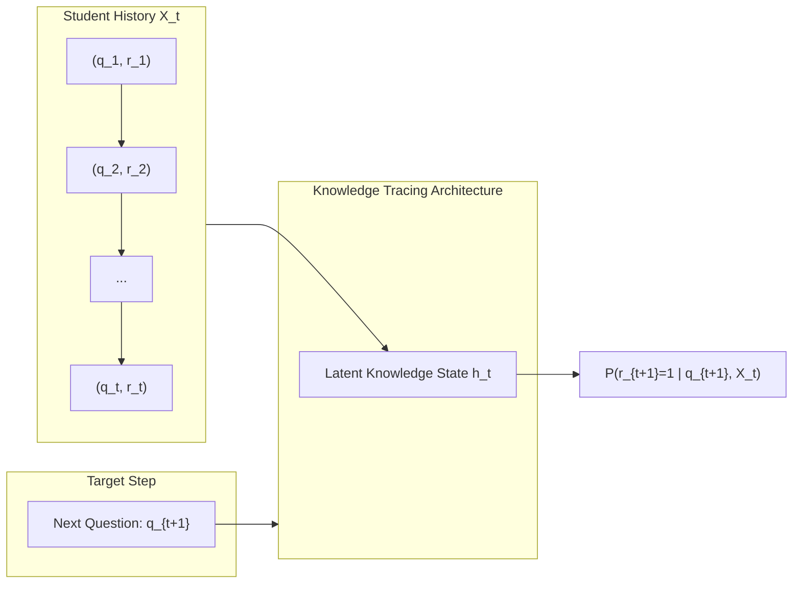
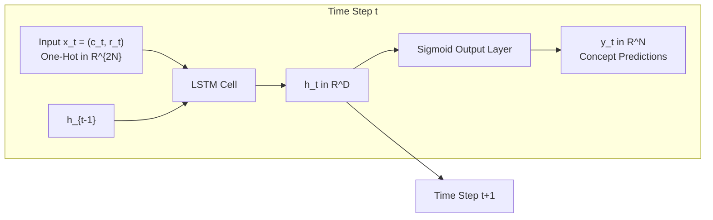
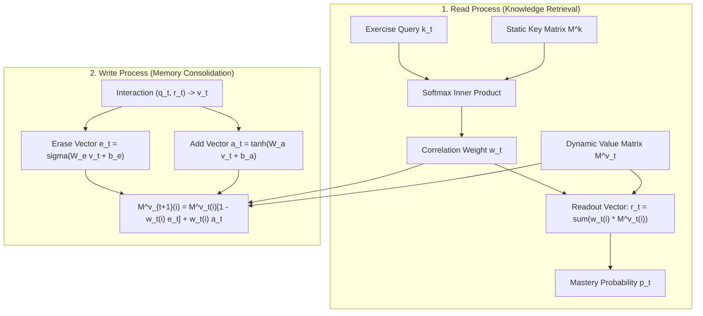
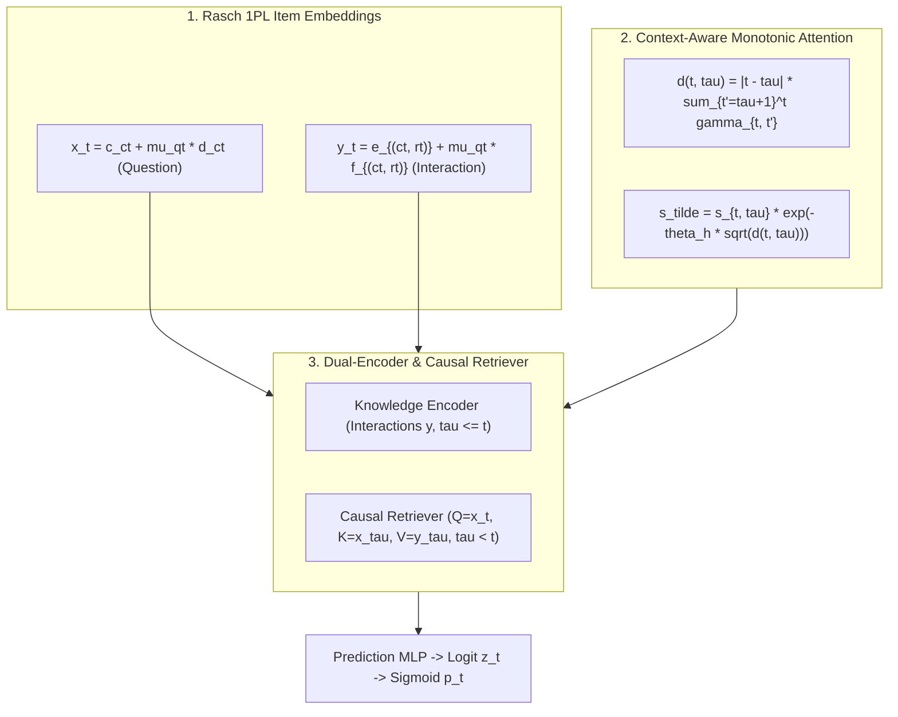
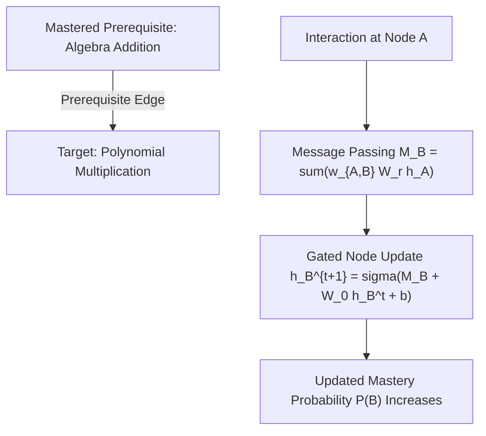
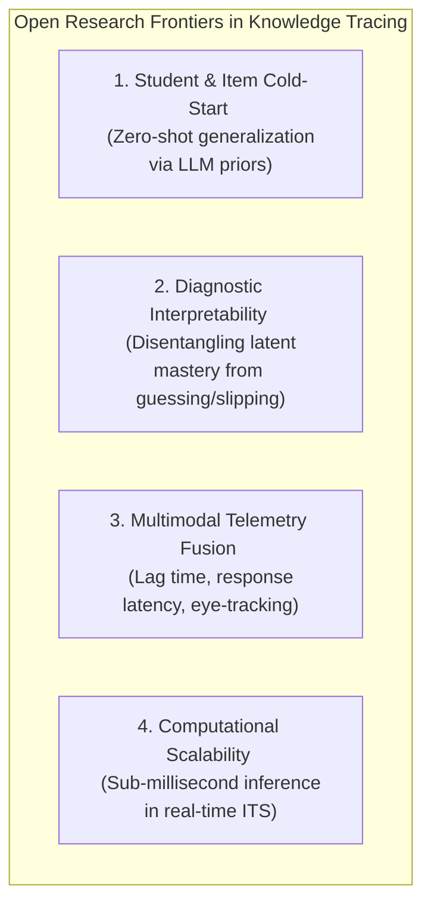

# A Comprehensive Academic Survey of Knowledge Tracing Architectures: From Markov Models to Transformer, Graph-Based, and Large Language Model Paradigms

---

## Abstract

**Knowledge Tracing (KT)** represents the foundational computational problem in Educational Data Mining (EDM) and Artificial Intelligence in Education (AIEd). It is the algorithmic backbone of modern Intelligent Tutoring Systems (ITS), designed to dynamically model and infer a student’s unobservable cognitive state based on a longitudinal sequence of their interactions with educational exercises. The ultimate objective of KT is to enable highly accurate predictions regarding a student's future performance, thereby facilitating personalized pedagogical interventions. 

This comprehensive survey provides an exhaustive architectural analysis of the field's evolution over the last several decades, delineating the transition from classical probabilistic and logistic frameworks, such as **Bayesian Knowledge Tracing (BKT)** and **Item Response Theory (IRT)**, to contemporary deep learning paradigms. By systematically categorizing modern KT architectures into:
1. **Recurrent Neural Network (RNN)-based models**,
2. **Memory-augmented models**,
3. **Attention and Transformer-based models**, and
4. **Graph-based models**,

this report deconstructs the specific mathematical mechanisms and structural innovations that address the limitations of their predecessors. Foundational and high-impact models—including **Deep Knowledge Tracing (DKT)**, **Dynamic Key-Value Memory Networks (DKVMN)**, **Context-Aware Attentive Knowledge Tracing (AKT)**, **Graph-based Knowledge Tracing (GKT)**, and **SAINT/SAINT+**—are structurally analyzed at the level of their core computer science implementations. 

Furthermore, this survey synthesizes the current state of benchmark evaluations and explores emerging architectural frontiers, including temporal point processes (**HawkesKT**), prerequisite-driven logical constraints (**PDKT**), physics-informed causal inference (**Temporal-PINN**), and the integration of semantic natural language processing via Large Language Models (**MonaCoBERT**, **LLM-KT**). The report concludes with an extensive analysis of open challenges in the field, critically examining the cold-start problem, multi-modal behavioral telemetry integration, the necessity for diagnostic interpretability, and the computational overhead of deploying massive neural architectures in real-time educational environments.

---

## 1. Introduction and Mathematical Formulation

Adaptive learning systems represent a fundamental paradigm shift in digital education, promising personalized pedagogical scaffolding tailored to the unique cognitive state, learning rate, and knowledge gaps of the individual learner. The computational engine driving this personalization is **Knowledge Tracing (KT)**.

### 1.1 Sequential Formulation

Formally, the knowledge tracing task is constructed as a sequential supervised learning problem operating on time-series data. 

Let a student's historical interaction sequence up to discrete time step $t$ be defined as:

$$\mathcal{X} = \{x_1, x_2, \dots, x_t\}$$

Within this sequence, each interaction is typically represented as a discrete tuple:

$$x_i = (q_i, r_i)$$

where:
* $q_i \in \mathcal{Q}$ denotes the specific question, exercise, or Knowledge Component (KC) attempted by the student;
* $r_i \in \{0, 1\}$ serves as a binary indicator of response correctness ($1 = \text{correct}$, $0 = \text{incorrect}$).

The primary mathematical objective of any KT model is to estimate the probability that the student will answer a future, unseen question $q_{t+1}$ correctly, denoted mathematically as the conditional probability:

$$P(r_{t+1} = 1 \mid q_{t+1}, \mathcal{X})$$

---

### 1.2 Classical Foundations: Bayesian Knowledge Tracing (BKT)

The earliest mathematically robust and widely adopted formulation of this problem was **Bayesian Knowledge Tracing (BKT)**, pioneered by Corbett & Anderson (1994), which models student learning through the lens of a **Hidden Markov Model (HMM)**.

In the classical BKT framework, a student's knowledge state regarding a specific, isolated Knowledge Component (KC) is modeled as an unobservable, binary latent variable—meaning the student is assumed to have either completely mastered ($L_n = 1$) or completely failed to master ($L_n = 0$) the skill. 

BKT relies on the continuous updating of four static probability parameters for each skill:
* $P(L_0)$: Initial probability of knowing the skill prior to any interaction.
* $P(T)$: Transition probability of moving from an unmastered to a mastered state after an opportunity to apply the skill ($P(L_n = 1 \mid L_{n-1} = 0)$).
* $P(G)$: Probability of **guessing** the correct answer despite not possessing mastery ($P(r_n = 1 \mid L_n = 0)$).
* $P(S)$: Probability of **slipping** (making an accidental mistake) despite possessing true mastery ($P(r_n = 0 \mid L_n = 1)$).

#### Posterior Updating Equations

The posterior probability of mastery is recursively updated using Bayesian inference equations:

* **If the student answers correctly ($r_n = 1$):**

$$P(L_n \mid \text{correct}) = \frac{P(L_{n-1})(1 - P(S))}{P(L_{n-1})(1 - P(S)) + (1 - P(L_{n-1}))P(G)}$$

* **If the student provides an incorrect response ($r_n = 0$):**

$$P(L_n \mid \text{incorrect}) = \frac{P(L_{n-1})P(S)}{P(L_{n-1})P(S) + (1 - P(L_{n-1}))(1 - P(G))}$$

* **Accounting for Learning Transition to the Next Step:**

$$P(L_{n+1}) = P(L_n \mid \text{obs}) + (1 - P(L_n \mid \text{obs})) \cdot P(T)$$

> [!WARNING] Structural and Psychological Limitations of BKT
> 1. **Binary Knowledge Assumption:** BKT fundamentally fails to capture the continuous, nuanced spectrum of human cognitive mastery.
> 2. **Strict First-Order Markov Assumption:** The current knowledge state depends exclusively on the immediately preceding state $L_{n-1}$, preventing BKT from capturing long-term dependencies, spaced repetition effects, or historical forgetting curves.
> 3. **Isolated Concept Silos:** BKT models each skill independently, ignoring complex prerequisite structures and topical transfer across curriculum graphs.

---

### 1.3 Logistic Formulations & Behavioral Precursors

To address some of BKT's limitations, earlier psychometric approaches leveraged generalized linear and logistic models:
* **Item Response Theory (IRT):** Formulates response probability as a logistic function of student latent ability $\alpha$ and item difficulty $\beta$:
  $$P(\text{correct} \mid \alpha, \beta) = c + \frac{1 - c}{1 + \exp(-(\alpha - \beta))}$$
  where $c$ is a pseudo-guessing parameter.
* **Performance Factors Analysis (PFA) & Additive Factors Model (AFM):** Incorporate past success and failure counts as explicit logistic regression covariates.
* **Engagement Tracing (Beck, 2005):** Proved that response latency and timing telemetry could categorize whether a student was actively engaged, reading, or guessing.

While these models provided continuous parameters for ability and difficulty, they lacked the sequential, dynamic updating mechanisms required to continuously track evolving knowledge trajectories over time.

---

## 2. Taxonomy of Deep Knowledge Tracing

The transition to deep neural networks beginning in 2015 eliminated rigid discrete-state assumptions by embedding questions, concepts, and student histories into continuous, high-dimensional vector spaces. 

The taxonomy below systematically categorizes modern KT architectures by their primary computational mechanism:

### Table 1: Systematic Taxonomy of Knowledge Tracing Architectures

| Architectural Category | Core Computational Mechanism | Primary Advantages | Structural Limitations | Seminal Models |
| :--- | :--- | :--- | :--- | :--- |
| **RNN-Based Models** | Recurrent Neural Networks (LSTMs, GRUs, BiLSTMs) encoding a compressed, continuous hidden state updated sequentially over time. | First to eliminate binary state assumptions; natively handles arbitrary sequence lengths; captures non-linear relationships. | Entangled hidden states lack interpretability; suffers from the "reconstruction problem" (forgetting early sequence data). | **DKT**, **EERNN**, **PDKT** |
| **Memory-Augmented Models** | External memory matrices separating static concept representation (Keys) from dynamically updated mastery levels (Values). | High interpretability at the concept level; enables explicit tracking of multiple concepts simultaneously via read/write memory heads. | Predefined memory slots limit scalability; early models struggled with long-term dependencies across distant time steps. | **DKVMN**, **SKVMN**, **DKVMN-KAPS** |
| **Attention & Transformer Models** | Self-attention and scaled dot-product attention capturing complex, long-range dependencies without recurrence, utilizing distance-decay. | Solves vanishing gradient issues in RNNs; highly effective at capturing relevance between current and distant past interactions. | Computationally expensive ($\mathcal{O}(L^2)$ complexity); standard positional encoding fails to perfectly capture human forgetting curves. | **SAKT**, **AKT**, **SAINT / SAINT+**, **simpleKT** |
| **Graph-Based Models** | Graph Neural Networks (GNNs) propagating information across structurally defined concept/question topological networks via message passing. | Explicitly models pedagogical relationships (prerequisites, similarities); updates related skills simultaneously during inference. | Graph construction relies heavily on expert annotation or transition matrices; massive graphs scale poorly in real-time inference. | **GKT**, **GIKT**, **DHKT** |
| **Temporal & Convolutional Models** | Temporal point processes (Hawkes), 1D Convolutional Neural Networks (CNNs), and physics-informed models mapping causal delays. | Mathematically mirrors cognitive processes like the Ebbinghaus forgetting curve and individualized learning rates. | Highly complex feature engineering required; sensitive to hyperparameter tuning for temporal decay functions. | **HawkesKT**, **CKT**, **Temporal-PINN** |
| **LLM & Semantic NLP Models** | Foundational Large Language Models (BERT, GPT variants) extracting dense semantic embeddings directly from question text. | Eliminates reliance on rigid Q-matrices; drastically reduces exercise-level cold start problems by understanding semantic similarity. | Extreme computational overhead; prone to hallucinating pedagogical relationships without strict instruction tuning. | **MonaCoBERT**, **LLM-KT** |

---

## 3. Architectural Deep Dives

---

### 3.1 The Sequence Modeling Foundation: Recurrent Neural Networks

#### 3.1.1 Deep Knowledge Tracing (DKT)

Introduced by Piech et al. (NeurIPS 2015), **Deep Knowledge Tracing (DKT)** fundamentally recast KT from a discrete probabilistic inference problem into a flexible sequential deep learning task. By leveraging **Long Short-Term Memory (LSTM)** networks, DKT bypassed the need for hand-crafted features or discrete transition matrices.

##### Mathematical Formulation

In standard DKT:
1. **Input Encoding:** The input $x_t \in \mathbb{R}^{2N}$ is a one-hot vector encoding both the concept $c_t \in \{1, \dots, N\}$ and binary response $r_t \in \{0, 1\}$:
   $$x_t = c_t + r_t \cdot N$$
2. **Hidden State Evolution:** The hidden state $h_t \in \mathbb{R}^D$ summarizes the student's mastery across all $N$ concepts:
   $$h_t = \text{LSTM}(x_t, h_{t-1})$$
3. **Prediction Layer:** Output probabilities across all $N$ concepts are computed via a linear projection and sigmoid activation:
   $$y_t = \sigma(W_{yh} h_t + b_y) \quad \in [0, 1]^N$$
   where $y_t^k$ represents the probability of answering concept $k$ correctly at time step $t+1$.
4. **Objective Function:** Trained end-to-end using masked binary cross-entropy:
   $$\mathcal{L} = -\sum_{t=1}^T \left( r_t \log y_{t-1}^{c_t} + (1 - r_t) \log (1 - y_{t-1}^{c_t}) \right)$$

> [!CAUTION] DKT's Structural Failures: The Reconstruction Problem
> Because $h_t$ compresses all $N$ skills into a single dense vector, DKT suffers from **state entanglement**. As a student solves exercises on unrelated concepts, $h_t$ drifts, often paradoxically predicting that the student has "forgotten" a concept they consistently answered correctly earlier in the sequence. Furthermore, DKT cannot localize which specific concept's representation changed after a given step.

---

#### 3.1.2 Exercise-Enhanced Recurrent Neural Network (EERNN)

While DKT relied entirely on anonymous one-hot IDs, it ignored the text of the exercises. Su et al. (2018) proposed **EERNN** to integrate Natural Language Processing (NLP) into sequential knowledge tracing.

* **Textual Semantic Embedding:** Given an exercise $e_i$ composed of word tokens $\{w_1, w_2, \dots, w_M\}$, EERNN uses a pre-trained Word2Vec embedding followed by a **Bidirectional LSTM (BiLSTM)** to compute forward $\overrightarrow{v}_m$ and backward $\overleftarrow{v}_m$ states:
  $$v_i = [\overrightarrow{v}_M \,\|\, \overleftarrow{v}_1]$$
* **Student Tracking:** The dense semantic vector $v_i$ is concatenated with response $r_i$ to form the input to a student-tracking LSTM. This directly resolves the **exercise-level cold start problem** by measuring semantic proximity to previously encountered problems.

---

### 3.2 External Memory Augmentation and Addressing Entanglement

To solve DKT's state entanglement and lack of diagnostic interpretability, Zhang et al. (2017) introduced the **Dynamic Key-Value Memory Network (DKVMN)**.

#### 3.2.1 Dynamic Key-Value Memory Networks (DKVMN)

DKVMN decouples knowledge representation into two dedicated memory matrices:
1. **Key Matrix ($M^k \in \mathbb{R}^{N \times d_k}$):** Static matrix storing concept representations.
2. **Value Matrix ($M^v_t \in \mathbb{R}^{N \times d_v}$):** Dynamic matrix where each row acts as a memory slot tracking the student's mastery level of the corresponding concept.

##### Read Process (Retrieval)
When a student attempts exercise $q_t$ with query embedding $k_t$:
1. Compute correlation weights $w_t \in \mathbb{R}^N$ over concept slots:
   $$w_t(i) = \text{softmax}(k_t^\top M^k(i))$$
2. Retrieve the student's mastery state vector $r_t$:
   $$r_t = \sum_{i=1}^N w_t(i) M^v_t(i)$$
3. Predict success via a 2-layer MLP:
   $$p_t = \sigma(W_2^\top \text{ReLU}(W_1^\top [r_t \,\|\, k_t] + b_1) + b_2)$$

##### Write Process (Consolidation)
After the response $r_t$ is observed, interaction tuple $(q_t, r_t)$ is embedded into growth vector $v_t \in \mathbb{R}^{d_v}$:
1. Compute Erase vector $e_t$ and Add vector $a_t$:
   $$e_t = \sigma(W_e v_t + b_e) \quad \in (0, 1)^{d_v}$$
   $$a_t = \tanh(W_a v_t + b_a) \quad \in (-1, 1)^{d_v}$$
2. Update each memory slot $i$ according to its relevance $w_t(i)$:
   $$\tilde{M}_t^v(i) = M_{t-1}^v(i) \odot \left[\mathbf{1} - w_t(i) e_t\right]$$
   $$M_t^v(i) = \tilde{M}_t^v(i) + w_t(i) a_t$$

---

#### 3.2.2 Evolving the Memory Paradigm: SKVMN and DKVMN-KAPS

* **Sequential Key-Value Memory Networks (SKVMN, Abdelrahman & Wang, 2019):**  
  DKVMN updates memory strictly based on the immediately preceding step. SKVMN introduces the **Hop-LSTM**, which chains hidden states of conceptually similar exercises across time, bypassing irrelevant intervening interactions to capture extended learning trajectories.
* **DKVMN-KAPS (Zhang et al., 2024):**  
  Integrates personalized cognitive traits. Uses hierarchical CNNs over recent interaction windows to dynamically compute a personalized **knowledge-absorption scalar** $\alpha_s$, scaling the Add vector during the Write process ($a_t \leftarrow \alpha_s a_t$) and dampening the Erase vector to reflect individual learning and retention speeds.

---

### 3.3 The Attention and Transformer Revolution

Recurrent and memory-matrix models struggle with long sequence degradation and sequential compute bottlenecks. Transformers address this via **scaled dot-product self-attention**, computing pairwise dependencies across any two time steps in $\mathcal{O}(1)$ operations.

---

#### 3.3.1 Self-Attentive Knowledge Tracing (SAKT)

Pandey & Karypis (EDM 2019) introduced **SAKT**, mapping educational interactions into Query, Key, and Value spaces:
* **Query ($Q$):** Target exercise embeddings $E \in \mathbb{R}^{L \times D}$.
* **Key ($K$) & Value ($V$):** Historical interaction embeddings $Y \in \mathbb{R}^{L \times D}$ encoding tuples $(e_i, r_i)$.
* **Attention Mechanism:**
  $$\text{Attention}(Q, K, V) = \text{softmax}\left(\frac{Q K^\top}{\sqrt{D}} + M_{\text{causal}}\right) V$$
  where $M_{\text{causal}}$ is an upper-triangular mask ensuring causality ($\tau \le t$).

> [!IMPORTANT] SAKT's Cognitive Limitation
> SAKT imported standard sinusoidal positional encodings directly from NLP. In educational sequences, time steps are cognitive events subject to **forgetting curves**, not translation-invariant grammatical positions. SAKT often assigns inappropriately high attention to topically similar exercises solved weeks or months prior.

---

#### 3.3.2 Context-Aware Attentive Knowledge Tracing (AKT)

Ghosh et al. (KDD 2020) proposed **AKT**, combining psychometric theory (**1PL Rasch IRT**) and cognitive psychology (**Ebbinghaus forgetting curves**) into a unified dual-encoder self-attention architecture.

##### 1. Rasch Model-Based Embeddings (1PL IRT)
Rather than allocating full $D$-dimensional vectors per question, AKT parameterizes item difficulty along a scalar degree of freedom $\mu_q \in \mathbb{R}$ with empirical Bayes $L_2$ shrinkage:
$$\mathbf{x}_t = \mathbf{c}_{c_t} + \mu_{q_t} \mathbf{d}_{c_t} \quad \in \mathbb{R}^D \tag{Question Embedding}$$
$$\mathbf{y}_t = \mathbf{e}_{(c_t, r_t)} + \mu_{q_t} \mathbf{f}_{(c_t, r_t)} \quad \in \mathbb{R}^D \tag{Interaction Embedding}$$
where $\mathbf{c}_c$ is the base concept embedding, $\mathbf{d}_c$ is the concept variation vector, and $\mu_q$ is regularized via $\lambda \sum \mu_q^2$.

##### 2. Context-Aware Monotonic Attention
AKT models Ebbinghaus forgetting by defining contextual distance $d(t, \tau)$ using intermediate attention masses:
$$d(t, \tau) = |t - \tau| \sum_{t' = \tau + 1}^t \gamma_{t, t'}$$
Each attention head $h$ learns an independent exponential decay rate $\theta_h = \text{softplus}(\gamma_h) > 0$:
$$\tilde{s}_{t, \tau}^{(h)} = s_{t, \tau}^{(h)} \cdot \exp\!\left(-\theta_h \sqrt{d^{(h)}(t, \tau)}\right)$$
$$\alpha_{t, \tau}^{(h)} = \text{softmax}_{\tau \le t}\left(\tilde{s}_{t, \tau}^{(h)}\right)$$

##### 3. Strictly Causal Dual-Encoder Retrieval
The knowledge retriever strictly enforces that predicting response $r_t$ uses values from $\tau \in \{1, \dots, t-1\}$ (`allow_current=False`, zero-padding $t=1$), eliminating future response leakage.

---

#### 3.3.3 Separated Self-Attentive Neural KT (SAINT and SAINT+)

Choi et al. (2020) and Shin et al. (2020) proposed **SAINT** and **SAINT+**, implementing a full encoder-decoder Transformer:
* **Separated Encoder-Decoder Streams:**
  - **Encoder:** Ingests *only* exercise sequence $e_{1:t}$ (the curriculum path).
  - **Decoder:** Ingests *only* student response sequence $r_{1:t-1}$ (the performance path).
* **Behavioral Telemetry in SAINT+:**
  SAINT+ incorporates two continuous behavioral telemetry streams into decoupled attention embeddings:
  - **Elapsed Time:** Active time spent on problem $t$.
  - **Lag Time:** Inactivity duration between interactions $t-1$ and $t$.
  This sensitivity captures the cognitive **spacing effect**—where distributed practice produces stronger long-term retention than massed practice.

---

#### 3.3.4 The Minimalist Baseline: simpleKT

Amidst escalating architectural complexity, Liu et al. (NeurIPS 2023) introduced **simpleKT**, challenging whether convoluted multi-head components are strictly necessary:
* Replaces complex multi-stream decoders with standard dot-product attention.
* Adopts Rasch-inspired item difficulty vectors while maintaining parameter compactness.
* Routinely matches or exceeds SAINT+ performance across standard benchmarks, underscoring that psychometric inductive bias often trumps raw architectural scale.

---

### 3.4 Graph-Based and Hierarchical Methodologies

Human knowledge is inherently structured as an interconnected topological graph with prerequisite and dependency edges.

#### 3.4.1 Graph-Based Knowledge Tracing (GKT)

Nakagawa et al. (2019) reformulated KT as a node-level time-series classification problem over a graph $\mathcal{G} = (\mathcal{V}, \mathcal{E})$ using **Graph Neural Networks (GNNs)**:

##### Message Passing Mechanism
When an interaction occurs at concept node $i$, information propagates to neighboring concepts $\mathcal{N}_i$:
$$M_i^{(l+1)} = \sum_{j \in \mathcal{N}_i} w_{i, j} W_r^{(l)} h_j^{(l)}$$
The recipient node updates its hidden state via a gated recurrence:
$$h_i^{(l+1)} = \sigma\left(M_i^{(l+1)} + W_0^{(l)} h_i^{(l)} + b\right)$$
If a student unexpectedly fails a fundamental prerequisite concept, GKT propagates this negative evidence, causing predicted mastery of dependent advanced skills to decrease in tandem.

---

#### 3.4.2 Scalability & Hierarchy: GIKT, DHKT, and PDKT

* **Graph-Interactive Knowledge Tracing (GIKT, Yang et al., 2020):**  
  Solves GKT's computational scaling issues over tens of thousands of questions by introducing **bipartite graph convolutions** mapping granular questions to high-level concept nodes.
* **Deep Hierarchical Knowledge Tracing (DHKT, Wang et al., 2019):**  
  Encodes educational taxonomy directly ($\text{Domain} \rightarrow \text{Topic} \rightarrow \text{Subtopic} \rightarrow \text{Question}$) to capture multi-level cognitive transfer.
* **Prerequisite-Driven Deep Knowledge Tracing (PDKT, Chen et al., 2018):**  
  Enforces prerequisite rules without GNN overhead by augmenting the loss function with an ordering penalty:
  $$P(m_{i, k_2, t_2} = 1) \le P(m_{i, k_1, t_1} = 1) \quad \text{if } k_1 \text{ is prerequisite of } k_2$$

---

### 3.5 Emerging Paradigms: Temporal Processes, Convolutions, and LLMs

* **Temporal Point Processes (HawkesKT, Wang et al., 2021):**  
  Employs Continuous-Time LSTMs (CTLSTM) governed by the Hawkes process. Student knowledge states continuously decay during intervals of inactivity and experience excitation bursts upon active practice.
* **Physics-Informed Neural Networks (Temporal-PINN, Lu et al., 2025):**  
  Formulates learning and cognitive decay as differential equations analogous to heat diffusion, enforcing physics-grounded smoothness constraints against behavioral noise.
* **Convolutional Knowledge Tracing (CKT, Shen et al., 2020):**  
  Applies 1D CNN filters over sliding interaction windows to capture local momentum and individualized learning rate dynamics.
* **Semantic Integration & Large Language Models (LLM-KT, 2024–2025):**  
  - **MonaCoBERT (Lee et al., 2022):** Combines ConvBERT with monotonic multi-head attention to extract semantic embeddings directly from question text, bypassing human Q-matrix tagging.
  - **LLM-KT:** Employs Parameter-Efficient Fine-Tuning (PEFT, LoRA) on foundational LLMs (LLaMA, Mistral). Recasts student interaction logs into structured natural language narratives, reframing knowledge tracing from numerical sequence modeling into semantic cognitive reasoning.

---

## 4. Datasets and Benchmark Evaluation

The evaluation of Knowledge Tracing models relies on curated, large-scale interaction datasets representing different pedagogical settings:

### Table 2: Standard Knowledge Tracing Benchmark Datasets

| Dataset | Origin & Domain | Interactions | Students | Concepts | Questions | Structural Characteristics |
| :--- | :--- | :---: | :---: | :---: | :---: | :--- |
| **`ASSISTments2009`** | Middle School Math | 325,637 | 4,151 | 110 | 16,891 | Moderate item sparsity (19.3 interactions/question). Primary benchmark for Rasch validation. |
| **`ASSISTments2015`** | Middle School Math | 708,631 | 19,840 | 100 | — | Concept-only dataset. Standard for validating non-Rasch and sequence-level models. |
| **`ASSISTments2017`** | Middle School Math | 942,816 | 1,709 | 102 | 3,162 | Rich longitudinal sequences (551.7 interactions/student). Dense question coverage. |
| **`Statics2011`** | College Engineering | 189,297 | 333 | 1,223 | — | Multi-step engineering problems with deeply nested, fine-grained concept hierarchies. |
| **`Algebra2005`** | Cognitive Tutor Algebra | 884,102 | 574 | 112 | 173,113 | Extreme question sparsity (5.1 interactions/question). Decisive test for IRT parameter shrinkage. |
| **`NIPS34` (Eedi)** | Diagnostic Math MCQs | 1,399,520 | 4,918 | 57 | 948 | Dense assessment data with diagnostic distractors probing specific misconceptions. |
| **`EdNet-KT1`** | AI Tutor Santa (TOEIC) | $>130\text{M}$ | $>780\text{k}$ | 188 | 13,169 | Massive-scale commercial dataset with detailed lag time and elapsed time telemetry. |
| **`Junyi Academy`** | E-learning Mathematics | $>25\text{M}$ | $>240\text{k}$ | 835 | — | Rich expert-annotated concept prerequisite graphs. Benchmark for GKT and graph models. |

---

### 4.1 Evaluation Metrics

1. **Area Under the ROC Curve (AUC):**  
   The primary metric in Knowledge Tracing. Because educational datasets are imbalanced (students generally answer correctly $60\%\text{--}80\%$ of the time), raw Accuracy (ACC) is misleading. AUC measures the model's threshold-independent ability to discriminate between correct and incorrect responses ($0.5 = \text{random guessing}$, $1.0 = \text{perfect discrimination}$).
2. **Root Mean Squared Error (RMSE):**  
   Measures calibration error between predicted probabilities $\hat{r}_t \in [0, 1]$ and binary outcomes $r_t \in \{0, 1\}$:
   $$\text{RMSE} = \sqrt{\frac{1}{M} \sum_{i=1}^M (\hat{r}_i - r_i)^2}$$
   Low RMSE is vital for student-facing dashboards where estimated mastery percentages must reflect true real-world proficiency.

---

## 5. Open Challenges and Future Directions

### 5.1 The Cold-Start Phenomenon
* **Student Cold-Start:** When a student first joins a tutoring platform, models lack historical interaction context and default to population averages. Prior knowledge estimation via diagnostic intake testing or collaborative filtering priors remains an active area of investigation.
* **Exercise Cold-Start:** Newly created curriculum items lack historical response logs. NLP-driven approaches (EERNN, MonaCoBERT) mitigate this by embedding question text, but zero-shot difficulty estimation without calibration data remains challenging.

### 5.2 Interpretability vs. Predictive Power
While deep learning models outperform classical BKT in predictive AUC, their continuous hidden states frequently act as diagnostic black boxes. Pedagogical stakeholders (teachers, instructional designers) require transparent, discrete evidence of mastery to prescribe remediation. Reconciling high-capacity neural representation with actionable cognitive diagnostic modeling (e.g., Q-matrix alignment, DINA models) is a paramount challenge.

### 5.3 Multi-Modal Behavioral Integration
Standard KT abstracts student interactions into binary correctness $r_t \in \{0, 1\}$. Real-world learning is multimodal. Incorporating response latency, idle lag times, hint requests, partial credit, and video/eye-tracking engagement streams into temporal architectures without causing overfitting will define the next generation of ITS.

### 5.4 Computational Overhead & Edge Deployment
Deploying massive multi-head Transformers or billion-parameter LLMs in production systems serving millions of concurrent students introduces prohibitive latency and cloud infrastructure costs. Minimalist architectures like **simpleKT** prove that intelligent psychometric feature engineering can match massive neural networks at a fraction of the compute budget. Balancing model capacity with sub-10ms inference latency is critical for practical adoption.

---

## 6. Conclusion

The architectural evolution of Knowledge Tracing represents a dynamic intersection of cognitive psychology, psychometrics, and deep learning:
1. **Probabilistic Beginnings:** BKT and IRT established formal mathematical foundations but were constrained by discrete Markov assumptions and static formulations.
2. **The Recurrent Leap:** DKT and EERNN demonstrated that human learning trajectories could be modeled continuously via high-dimensional hidden states.
3. **Disentangled Memory:** DKVMN proved that external memory networks could explicitly separate static curriculum representations from dynamic student mastery tracking.
4. **Attentive Cognitive Grounding:** SAKT, AKT, and SAINT demonstrated that attention mechanisms, when properly constrained by monotonic forgetting decay and Rasch difficulty shrinkage, set the definitive state of the art.
5. **Topological & Semantic Frontiers:** Graph neural networks (GKT) and Large Language Models (LLM-KT) continue to expand KT from numerical sequence prediction into structural, semantically grounded cognitive reasoning.

As Knowledge Tracing matures, the research frontier is shifting from raw AUC optimization toward **diagnostic transparency**, **multimodal behavioral synthesis**, and **computationally efficient real-time deployment**—ensuring that computational models translate directly into personalized, equitable educational outcomes.
