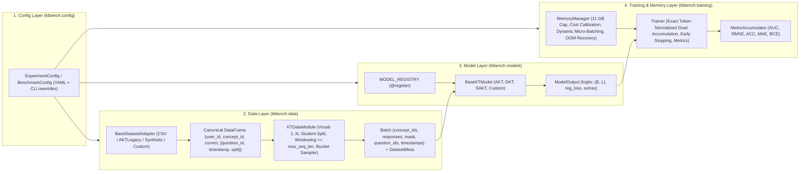

# Architecture & Developer Guide (`ktbench`)

This document explains the architectural design of **`ktbench`**, how it satisfies the **Apple Silicon M3 (16 GB Unified Memory / 11 GB GPU cap)** hardware constraints, and provides step-by-step guides for researchers adding **new Knowledge Tracing models** or **new educational datasets**.

---

## 1. Architectural Design & Decoupling Principles

The legacy AKT repository (`arghosh/AKT`, PyTorch 1.2) tightly coupled data parsing, global `cuda` device state, hardcoded dataset dimensions (`if dataset in {"assist2009_pid"}: params.n_question = 110`), and model-specific tensor transpositions (`if model_type in transpose_data_model`) inside the training loop.

`ktbench` replaces this with a strictly decoupled, 4-layer OOP architecture where adjacent layers communicate only through immutable, typed contracts:



### Key Decoupling Invariants
1. **Zero Model Branches in Data or Trainer:** Neither [`KTDataModule`](../ktbench/data/datamodule.py) nor [`Trainer`](../ktbench/training/trainer.py) ever inspects the model name. Every model consumes the same [`Batch`](../ktbench/data/dataset.py) dataclass and returns a [`ModelOutput`](../ktbench/models/base.py).
2. **Zero Dataset Branches in Models:** Models never hardcode vocabulary sizes. They receive [`DatasetMeta`](../ktbench/data/schema.py) (`n_concepts`, `n_questions`, `has_timestamps`, `max_seq_len`) at construction time. If a dataset lacks `question_id`s (`meta.has_questions == False`), [`AKT`](../ktbench/models/akt.py) automatically disables its Rasch difficulty branch (`AKT-NR`).
3. **Aligned Causal Prediction Contract:** Across **all** models (recurrent or attention-based), `output.logits[:, t]` is the pre-sigmoid prediction for `batch.responses[:, t]` given `concept_ids[:, :t+1]`, `question_ids[:, :t+1]`, and strictly past responses `responses[:, :t]`. This guarantees that token masking, loss computation, and metric accumulation are 100% identical across models.

---

## 2. Apple M3 (16 GB Unified Memory / 11 GB Cap) Optimization Strategy

On an Apple Silicon M3 MacBook with 16 GB of unified memory, macOS and background processes occupy ~4–5 GB. If PyTorch allocates beyond ~11 GB, macOS begins paging GPU buffers to SSD swap, causing severe thermal/swap thrashing or process termination. Furthermore, self-attention models like AKT and SAKT have activation memory that scales **quadratically** with sequence length, $\mathcal{O}(B \cdot H \cdot L^2)$.

`ktbench` implements a five-tier defense in [`ktbench/device.py`](../ktbench/device.py), [`ktbench/data/dataset.py`](../ktbench/data/dataset.py), and [`ktbench/training/memory.py`](../ktbench/training/memory.py):

| Tier | Mechanism | Where Implemented | Why It Matters on 16 GB M3 |
| :--- | :--- | :--- | :--- |
| **1. Backend & Fallback** | `resolve_device("auto")` selects `mps` $\rightarrow$ `cuda` $\rightarrow$ `cpu` and sets `PYTORCH_ENABLE_MPS_FALLBACK=1`. | [`ktbench/device.py`](../ktbench/device.py) | Runs natively on M3 Metal GPU while transparently falling back on CPU if a future custom model uses an unimplemented Metal kernel. |
| **2. Hard Allocator Ceiling** | `torch.mps.set_per_process_memory_fraction(fraction)` computed against `torch.mps.recommended_max_memory()` for `memory_cap_gb: 11.0`. | [`apply_memory_cap()`](../ktbench/device.py) | Converts catastrophic macOS system-wide swap freezes into catchable `torch.OutOfMemoryError` exceptions at the 11 GB boundary. |
| **3. Sequence Length Capping & Length-Bucketed Dynamic Padding** | Long student histories are windowed to `max_seq_len` (default `200`). `LengthBucketBatchSampler` groups similar-length sequences and `collate_sequences` pads only to the batch's max length, not the global max length. | [`preprocessing.py`](../ktbench/data/preprocessing.py), [`dataset.py`](../ktbench/data/dataset.py) | Bounds $L \le L_{\max}$ and eliminates wasted $\mathcal{O}(L^2)$ attention cells on padding tokens. |
| **4. Probed Cost-Model Micro-Batching & Exact Gradient Accumulation** | Each model declares `memory_complexity = p` ($p=1$ for RNNs, $p=2$ for Transformers). At startup, `MemoryManager.calibrate()` runs two tiny probe batches on MPS, measures actual activation bytes per cost unit $B \cdot L^p$, and computes a safe cost budget (`safety_factor: 0.75`). Every logical batch is greedily split (`MemoryManager.plan()`) into length-trimmed micro-batches that fit the budget. Losses are summed over valid tokens and divided by `batch.num_tokens`, so accumulated gradients are **mathematically identical** to an unsplit batch. | [`memory.py`](../ktbench/training/memory.py), [`trainer.py`](../ktbench/training/trainer.py) | Decouples the statistical hyperparameter `train.batch_size` from physical GPU memory. Even `batch_size: 512` or `max_seq_len: 1000` trains smoothly inside 11 GB. |
| **5. Automatic OOM Recovery** | If an allocation spike still triggers `OutOfMemoryError`, `Trainer` catches it, clears gradients and `torch.mps.empty_cache()`, **halves** `MemoryManager.budget`, re-plans the batch into smaller micro-batches, and retries the exact same step without losing data. | [`Trainer._train_step()`](../ktbench/training/trainer.py) | Guarantees zero-crash training even under external memory pressure from other macOS apps. |

---

## 3. How to Add a New Custom Knowledge Tracing Model

Adding a new model to `ktbench` requires **zero edits** to the data pipeline, trainer, evaluator, or CLI. You simply:
1. Define a `@dataclass` holding your model's hyperparameters.
2. Subclass [`BaseKTModel`](../ktbench/models/base.py), decorate it with `@MODEL_REGISTRY.register("your_name")`, and implement `forward(self, batch: Batch) -> ModelOutput`.

### Step-by-Step Example: Adding `DKTPlus` (Regularized DKT)

Suppose you want to implement **DKT+** (Yeung & Yeung, 2018), which augments DKT with reconstruction and waviness regularization losses ($w_1, w_2$).

Create `ktbench/models/dktplus.py` (and import it in `ktbench/models/__init__.py`):

```python
from dataclasses import dataclass
import torch
import torch.nn.functional as F
from torch import nn

from ktbench.data.dataset import Batch
from ktbench.data.schema import DatasetMeta
from ktbench.models.base import MODEL_REGISTRY, BaseKTModel, ModelOutput, interaction_index


@dataclass
class DKTPlusConfig:
    emb_dim: int = 128
    hidden_dim: int = 256
    dropout: float = 0.2
    lambda_w1: float = 0.1   # L1 waviness penalty between consecutive predictions
    lambda_w2: float = 1.0   # L2 waviness penalty between consecutive predictions


@MODEL_REGISTRY.register("dktplus")
class DKTPlus(BaseKTModel):
    Config = DKTPlusConfig
    memory_complexity = 1     # 1 for O(B*L) recurrent models, 2 for O(B*L^2) attention models

    def __init__(self, cfg: DKTPlusConfig, meta: DatasetMeta) -> None:
        super().__init__(cfg, meta)
        self.n_concepts = meta.n_concepts
        self.embed = nn.Embedding(2 * meta.n_concepts + 1, cfg.emb_dim, padding_idx=0)
        self.lstm = nn.LSTM(cfg.emb_dim, cfg.hidden_dim, batch_first=True)
        self.h0 = nn.Parameter(torch.zeros(cfg.hidden_dim))
        self.out = nn.Sequential(nn.Dropout(cfg.dropout), nn.Linear(cfg.hidden_dim, meta.n_concepts + 1))

    def forward(self, batch: Batch) -> ModelOutput:
        # 1. Encode interactions (c_t, r_t)
        inter = interaction_index(batch.concept_ids, batch.responses, self.n_concepts)
        h, _ = self.lstm(self.embed(inter))

        # 2. Shift states by 1 so step t only uses responses < t (CAUSAL CONTRACT!)
        h_prev = torch.cat([self.h0.expand(h.size(0), 1, -1), h[:, :-1]], dim=1)
        all_logits = self.out(h_prev)  # (B, L, C + 1)

        # 3. Gather logits for the target concept c_t at each step t
        logits = all_logits.gather(-1, batch.concept_ids.unsqueeze(-1)).squeeze(-1)

        # 4. Optional model-specific regularizer (summed over valid transitions)
        probs = torch.sigmoid(all_logits[:, :, 1:])  # (B, L, C)
        diff = probs[:, 1:] - probs[:, :-1]          # (B, L-1, C)
        valid_pair = (batch.mask[:, 1:] & batch.mask[:, :-1]).unsqueeze(-1)
        w1 = (diff.abs() * valid_pair).mean(-1).sum()
        w2 = (diff.pow(2) * valid_pair).mean(-1).sum()
        reg_loss = self.cfg.lambda_w1 * w1 + self.cfg.lambda_w2 * w2

        return ModelOutput(logits=logits, reg_loss=reg_loss)
```

### Checklist for Custom Models
* **Causal Contract:** Does `logits[:, t]` depend *only* on `responses[:, :t]`? Run `pytest tests/test_models.py -k test_forward_backward_and_causality`—it automatically tests every registered model in `MODEL_REGISTRY` by flipping `responses[:, t:]` and asserting `logits[:, :t+1]` is unchanged!
* **Padding Invariance:** Does appending right-padding (`mask == False`, ID `0`) leave valid token predictions unchanged? `test_right_padding_invariance` verifies this automatically for all registered models.
* **Comparing in a Benchmark:** Add your model under `models:` in any benchmark YAML:
  ```yaml
  models:
    dktplus:
      name: dktplus
      params: {hidden_dim: 256, lambda_w1: 0.1, lambda_w2: 1.0}
  ```

---

## 4. How to Integrate a New Educational Dataset

All datasets enter the pipeline through [`BaseDatasetAdapter`](../ktbench/data/adapters.py), whose sole job is converting raw files into a canonical long-format `pandas.DataFrame` with these columns:

| Column | Required? | Type | Description |
| :--- | :---: | :--- | :--- |
| `user_id` | **Yes** | any hashable | Unique student identifier |
| `concept_id` | **Yes** | any hashable | Knowledge component / skill ($c_t$) |
| `correct` | **Yes** | `0`/`1` (or float in $[0,1]$) | Graded correctness ($r_t$; floats binarized at $\ge 0.5$) |
| `question_id` | Optional | any hashable | Specific item / problem ID ($q_t$; enables Rasch embeddings in AKT-R) |
| `timestamp` | Optional | numeric | Chronological ordering key within each student |
| `split` | Optional | `"train"` / `"valid"` / `"test"` | Pre-defined split (if omitted, `KTDataModule` performs a leakage-free student-level split) |

Everything downstream (1-based contiguous vocabulary encoding with `0 = pad`, student-level train/valid/test splitting, chronological sorting, windowing to `max_seq_len`, length-bucketed sampling) is handled automatically by [`KTDataModule`](../ktbench/data/datamodule.py).

### Option A: Zero-Code Integration (Standard CSV / TSV / Parquet)

If your dataset is already a tabular event log (e.g., **ASSISTments 2009/2017**, **EdNet-KT1**, **Junyi Academy**, **Algebra 2005**), use the built-in `csv` adapter in YAML with a column map—no Python code needed:

```yaml
data:
  adapter: csv
  adapter_params:
    path: data/assist2009/skill_builder_data.csv
    columns:
      user_id: user_id
      question_id: problem_id
      concept_id: skill_id
      correct: correct
      timestamp: order_id
    read_kwargs:
      encoding: latin-1
  split: [0.7, 0.1, 0.2]
  max_seq_len: 200
```

### Option B: Zero-Code Integration (3-Line or 4-Line AKT / DKVMN Format)

For datasets formatted in the classic 3-line (concept-only) or 4-line (`_pid`, with problem IDs) format used by the DKVMN and AKT repositories, use the built-in `akt_legacy` adapter (see [`configs/akt_assist2009_legacy.yaml`](../configs/akt_assist2009_legacy.yaml)).

### Option C: Custom Python Adapter (Multi-File / Custom Schema)

If a dataset requires custom preprocessing (for example, **EdNet-KT1**, which stores one CSV file per student plus a separate `questions.csv` metadata table mapping `question_id` $\rightarrow$ `tags`), subclass [`BaseDatasetAdapter`](../ktbench/data/adapters.py) and decorate with `@ADAPTER_REGISTRY.register`:

```python
from pathlib import Path
import pandas as pd
from ktbench.data import schema as S
from ktbench.data.adapters import ADAPTER_REGISTRY, BaseDatasetAdapter


@ADAPTER_REGISTRY.register("ednet_kt1")
class EdNetKT1Adapter(BaseDatasetAdapter):
    def __init__(self, root_dir: str, max_users: int = 5000) -> None:
        super().__init__(name="ednet_kt1")
        self.root = Path(root_dir)
        self.max_users = max_users

    def load_raw(self) -> pd.DataFrame:
        # 1. Load question -> primary concept mapping
        q_meta = pd.read_csv(self.root / "contents" / "questions.csv")
        q_to_concept = q_meta.set_index("question_id")["part"].to_dict()
        q_to_ans = q_meta.set_index("question_id")["correct_answer"].to_dict()

        # 2. Read per-student interaction logs
        frames = []
        for user_file in sorted((self.root / "KT1").glob("u*.csv"))[: self.max_users]:
            df = pd.read_csv(user_file)
            df[S.USER] = user_file.stem
            df[S.QUESTION] = df["question_id"]
            df[S.CONCEPT] = df["question_id"].map(q_to_concept)
            df[S.CORRECT] = (df["user_answer"] == df["question_id"].map(q_to_ans)).astype(int)
            frames.append(df[[S.USER, S.QUESTION, S.CONCEPT, S.CORRECT, S.TIMESTAMP]])

        return pd.concat(frames, ignore_index=True)
```

Once registered, reference `adapter: ednet_kt1` in any experiment or benchmark YAML to compare `akt`, `dkt`, `sakt`, and your custom models head-to-head on the new dataset.
