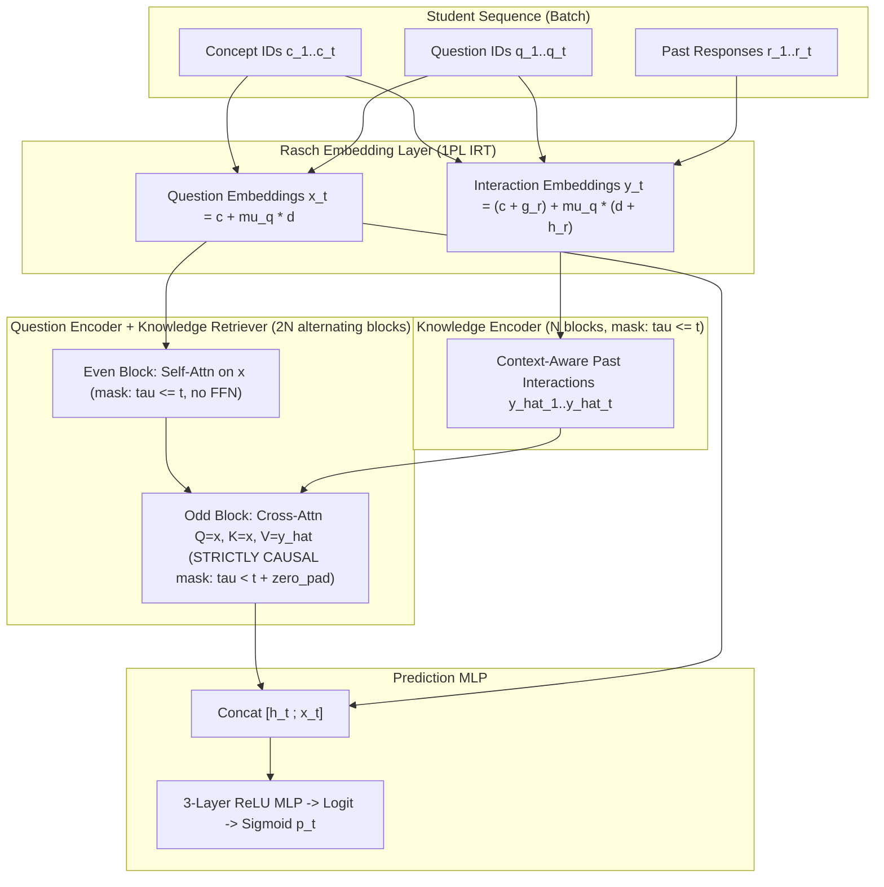

# Theoretical Foundations of Context-Aware Attentive Knowledge Tracing (AKT)

> **Reference:** Aritra Ghosh, Neil Heffernan, and Andrew S. Lan, *"Context-Aware Attentive Knowledge Tracing,"* in **Proceedings of the 26th ACM SIGKDD International Conference on Knowledge Discovery & Data Mining (KDD '20)**, 2020, pp. 2330–2339. ([arXiv:2007.12324](https://arxiv.org/abs/2007.12324))

---

## 1. Problem Formulation: Knowledge Tracing

In Knowledge Tracing (KT), a student's learning history up to discrete time step $t-1$ is observed as an ordered sequence of interactions:

$$\mathcal{H}_{t-1} = \{(q_1, c_1, r_1), (q_2, c_2, r_2), \dots, (q_{t-1}, c_{t-1}, r_{t-1})\}$$

where at each step $\tau \in \{1, \dots, t\}$:
* $c_\tau \in \{1, \dots, C\}$ is the **knowledge concept** (skill / knowledge component) tested by the exercise;
* $q_\tau \in \{1, \dots, Q\}$ is the specific **question** (item / problem ID) instantiated from concept $c_\tau$;
* $r_\tau \in \{0, 1\}$ is the student's **binary graded response** ($1 = \text{correct}$, $0 = \text{incorrect}$).

Given $\mathcal{H}_{t-1}$ and the next exercise $(q_t, c_t)$, the goal is to predict the mastery probability:

$$\hat{r}_t = P(r_t = 1 \mid q_t, c_t, \mathcal{H}_{t-1})$$

> **Causal Constraint (No Peeking):** When predicting $\hat{r}_t$, the model is permitted to observe the current question and concept $(q_t, c_t)$ up to index $t$, but may only observe responses $r_{<t} = (r_1, \dots, r_{t-1})$ strictly prior to $t$.

---

## 2. Why Classical Attention Fails in Cognitive Modeling

Earlier self-attentive KT models (such as **SAKT**, Pandey & Karypis 2019) directly imported the standard Transformer architecture from NLP into education:
1. **Fixed Sinusoidal / Learned Positional Encodings:** Standard positional encodings treat time steps as translation-invariant syntactic positions rather than cognitive events subject to **memory decay**.
2. **Over-parameterized Question Embeddings:** Indexing a free $D$-dimensional embedding vector per question ($Q \times D$ parameters, where $Q \gg C$) severely overfits on sparse questions that only a handful of students ever attempt, forcing many KT models to discard question IDs altogether and treat all questions sharing a concept $c$ as identical.
3. **Shallow Single-Pass Representation:** Raw embeddings of questions and interactions ignore the surrounding sequence of exercises a student was working on.

AKT resolves these three limitations by integrating **cognitive psychology** (Ebbinghaus forgetting curves) and **psychometrics** (Rasch / 1PL Item Response Theory) directly into a dual-encoder self-attention architecture.

---

## 3. Core Innovation 1: Rasch Model-Based Embeddings (1PL IRT)

### 3.1 Psychometric Motivation
In classical **1-Parameter Logistic Item Response Theory ( the Rasch Model )**, the probability that a student with latent ability $\theta$ answers question $q$ (belonging to concept $c$) correctly is governed by the difference between ability and a scalar item difficulty $\mu_q$:

$$P(r = 1 \mid \theta, q) = \sigma(\theta - (\beta_c + \mu_q)) = \frac{1}{1 + \exp(-(\theta - \beta_c - \mu_q))}$$

Crucially, individual questions within a concept $c$ do **not** require unconstrained $D$-dimensional vectors; they differ along a **single scalar difficulty degree of freedom** $\mu_q \in \mathbb{R}$.

### 3.2 Mathematical Formulation in AKT
AKT generalizes the Rasch model to vector embeddings (`ktbench/models/akt.py` $\rightarrow$ [`RaschEmbedding`](../ktbench/models/akt.py)). Each question $q_t$ with concept $c_t$ and response $r_t$ is embedded as:

$$\mathbf{x}_t = \mathbf{c}_{c_t} + \mu_{q_t} \, \mathbf{d}_{c_t} \quad \in \mathbb{R}^D \tag{Question Embedding}$$

$$\mathbf{y}_t = \mathbf{e}_{(c_t, r_t)} + \mu_{q_t} \, \mathbf{f}_{(c_t, r_t)} \quad \in \mathbb{R}^D \tag{Interaction Embedding}$$

where:
* $\mathbf{c}_{c_t} \in \mathbb{R}^D$ is the base **concept embedding**;
* $\mathbf{d}_{c_t} \in \mathbb{R}^D$ is the **concept variation vector** defining the direction in embedding space along which questions of concept $c_t$ shift as their difficulty changes;
* $\mu_{q_t} \in \mathbb{R}$ is the **scalar question difficulty parameter** (only **1 parameter per question**, initialized to $0$ so the model starts identical to a concept-level model);
* In the compact additive parameterization (`separate_qa=False`, paper default), the interaction terms share the concept vectors via response vectors $\mathbf{g}_{r_t}, \mathbf{h}_{r_t} \in \mathbb{R}^D$:
  $$\mathbf{e}_{(c_t, r_t)} = \mathbf{c}_{c_t} + \mathbf{g}_{r_t}, \qquad \mathbf{f}_{(c_t, r_t)} = \mathbf{d}_{c_t} + \mathbf{h}_{r_t}$$

### 3.3 Regularization (Shrinkage Toward Concept Mean)
To prevent overfitting on rarely seen questions, AKT penalizes the squared scalar difficulties with an $L_2$ regularizer controlled by $\lambda > 0$ (`l2=1e-5`):

$$\mathcal{R}_{\text{Rasch}} = \lambda \sum_{(t:\,\text{valid})} \mu_{q_t}^2$$

If a question $q$ appears only once or twice in the training set, the gradient of the binary cross-entropy with respect to $\mu_q$ is small and $\mu_q$ shrinks toward $0$, gracefully falling back to the well-estimated concept embedding $\mathbf{c}_{c_t}$ (an empirical Bayes / hierarchical shrinkage effect).

---

## 4. Core Innovation 2: Context-Aware Monotonic Attention

### 4.1 Cognitive Science: Forgetting Curves & Temporal Decay
Hermann Ebbinghaus's **forgetting curve** establishes that memory retention decays exponentially over time unless reinforced:

$$R(\Delta t) = \exp(-\theta \, \Delta t), \qquad \theta > 0$$

However, in an educational sequence, raw index distance $|t - \tau|$ is an inadequate proxy for cognitive forgetting:
* If a student practiced algebra at $\tau = 5$, then spent steps $6 \dots 19$ on unrelated geometry, and returns to algebra at $t = 20$, the intervening steps did not reinforce algebra.
* Conversely, if steps $\tau+1 \dots t$ were closely related to the query at $t$ (high conceptual similarity), the contextual history is dense with relevant activity.

### 4.2 Context-Aware Distance $d(t, \tau)$
Let $\mathbf{q}_t, \mathbf{k}_\tau, \mathbf{v}_\tau \in \mathbb{R}^{D_k}$ be the query, key, and value projections inside a single attention head ($D_k = D / H$). First, compute the un-decayed scaled dot-product similarity and its causal softmax weights $\gamma_{t, t'}$:

$$s_{t, \tau} = \frac{\mathbf{q}_t^\top \mathbf{k}_\tau}{\sqrt{D_k}}, \qquad \gamma_{t, t'} = \frac{\exp(s_{t, t'})}{\sum_{\tau' \le t} \exp(s_{t, \tau'})}$$

AKT defines the **context-aware distance** $d(t, \tau)$ between query time $t$ and past key time $\tau \le t$ (`ktbench/models/akt.py` $\rightarrow$ [`monotonic_attention`](../ktbench/models/akt.py)) as:

$$d(t, \tau) = |t - \tau| \sum_{t' = \tau + 1}^{t} \gamma_{t, t'} \tag{Contextual Distance}$$

> **Stop-Gradient Detail:** Following the paper and reference code, $d(t, \tau)$ is computed inside `torch.no_grad()` so that gradients flow through the decay rate $\theta$ and the base attention scores $s_{t, \tau}$ cleanly without higher-order feedback instability.

**Intuition of $d(t, \tau)$:**
* The term $\sum_{t' = \tau + 1}^{t} \gamma_{t, t'} \in [0, 1]$ measures the **cumulative relevance of all exercises attempted between $\tau$ and $t$** to the current query $t$.
* If the student practiced many similar exercises between $\tau$ and $t$, those more recent exercises absorb the attention mass ($\sum_{t'=\tau+1}^t \gamma_{t,t'}$ is large), making the older attempt at $\tau$ effectively more distant ($d(t,\tau)$ is large) so the model relies on the fresher attempts instead.
* If no similar exercise occurred between $\tau$ and $t$ ($\sum_{t'=\tau+1}^t \gamma_{t,t'} \approx 0$), $d(t, \tau)$ stays small even when $|t - \tau|$ is large—allowing the model to recall the last time that specific skill was practiced!

### 4.3 Monotonic Exponential Decay Kernel
Each attention head $h \in \{1, \dots, H\}$ learns a raw parameter $\gamma_h \in \mathbb{R}$, transformed via $\text{Softplus}$ to guarantee a strictly positive decay rate $\theta_h = \log(1 + e^{\gamma_h}) > 0$:

$$\tilde{s}_{t, \tau}^{(h)} = s_{t, \tau}^{(h)} \cdot \exp\!\left(-\theta_h \sqrt{d^{(h)}(t, \tau)}\right)$$

$$\alpha_{t, \tau}^{(h)} = \text{softmax}_{\tau \in \mathcal{A}(t)}\!\left(\tilde{s}_{t, \tau}^{(h)}\right)$$

Because different heads learn different decay rates $\theta_h$, a single multi-head layer simultaneously captures **short-term working memory** (large $\theta_h$, rapid decay) and **long-term mastery** (small $\theta_h$, slow decay).

---

## 5. Core Innovation 3: Dual-Encoder & Causal Knowledge Retriever

Rather than passing raw embeddings directly into a single cross-attention layer, AKT constructs **context-aware representations** using two coupled stacks (`ktbench/models/akt.py` $\rightarrow$ [`AKT`](../ktbench/models/akt.py)):

### 5.1 Knowledge Encoder (`knowledge_encoder`)
Applies $N$ blocks of monotonic self-attention over the interaction embeddings $\mathbf{y}_{1:T}$ with mask $\tau \le t$ (`allow_current=True`), producing context-aware interaction encodings $\hat{\mathbf{y}}_{1:T}$. At index $\tau$, $\hat{\mathbf{y}}_\tau$ summarizes the student's performance at step $\tau$ in the context of their performances on preceding exercises $1 \dots \tau$.

### 5.2 Interleaved Question Encoder & Causal Knowledge Retriever (`retriever`)
Applies $2N$ blocks alternating between:
1. **Question Self-Attention (even blocks, $\tau \le t$, `allow_current=True`, `apply_ffn=False`):**Contextualizes the question representation $\hat{\mathbf{x}}_t$ using the sequence of questions up to $t$.
2. **Causal Knowledge Retrieval (odd blocks, $\tau < t$, `allow_current=False`, `apply_ffn=True`):** Queries with $\hat{\mathbf{x}}_t$, keys with $\hat{\mathbf{x}}_{\tau}$, and retrieves values from $\hat{\mathbf{y}}_{\tau}$ strictly over past indices $\tau \in \{1, \dots, t-1\}$.
   * **Zero-Padding at $t=1$:** At the very first time step $t=1$, the set of past indices $\{\tau < 1\}$ is empty. The retriever explicitly zeroes out row $t=1$ (`zero_pad=True`) so the student's initial prediction depends solely on the question embedding $\mathbf{x}_1$ (prior item difficulty) before any responses are observed.

### 5.3 Prediction Head & End-to-End Objective
The retrieved knowledge state $\tilde{\mathbf{x}}_t \in \mathbb{R}^D$ is concatenated with the un-contextualized Rasch question embedding $\mathbf{x}_t \in \mathbb{R}^D$ and passed through a 3-layer ReLU MLP to produce the logit $z_t$, trained end-to-end with masked Binary Cross-Entropy plus the Rasch $L_2$ penalty:

$$\mathcal{L}(\Theta) = \frac{1}{\sum_{b,t} m_{b,t}} \left( \sum_{b,t} m_{b,t} \, \text{BCEWithLogits}(z_{b,t}, r_{b,t}) + \lambda \sum_{b,t} m_{b,t} \, \mu_{q_{b,t}}^2 \right)$$

where $m_{b,t} \in \{0, 1\}$ masks out right-padded positions.
